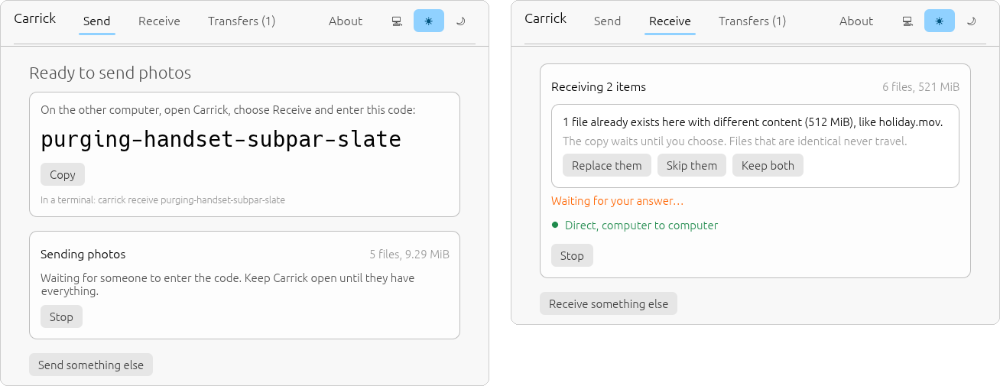
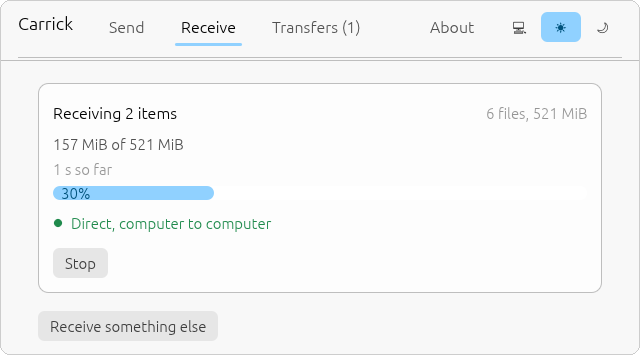
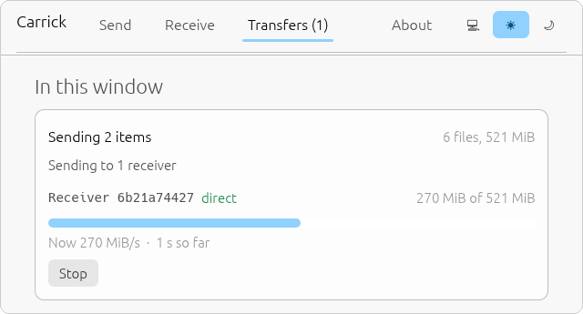
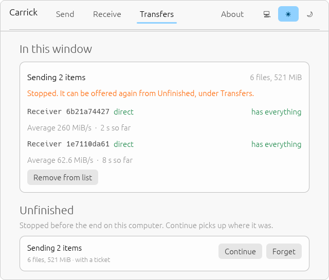
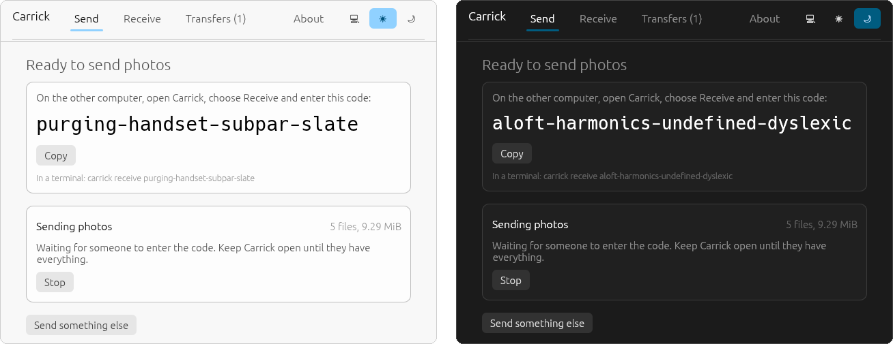

<p align="center">
  
</p>

<h1 align="center">Carrick</h1>

<p align="center">
  Send files and folders from one computer to another, wherever they are:<br>
  directly, encrypted end to end, verified piece by piece, and carrying on by
  itself after a dropped connection. For Windows and Linux.
</p>

<p align="center">
  <a href="https://github.com/johan-socarras/Carrick/actions/workflows/ci.yml"></a>
  <a href="#license"></a>
  
  
</p>



Moving 100 GB between two computers in different places usually means one of
two things. A cloud service, with its size limits and the wait to upload
everything before the other side can start downloading. Or a direct transfer
that someone has to watch, because a dropped connection, a laptop going to
sleep or a restart leaves it half done.

Carrick sends straight from one computer to the other, and the transfer does
not need anyone watching it. Both sides keep their state on disk: after a cut,
a closed window or a reboot, it picks up from the last verified piece. On the
other computer you only type four words.

## Contents

[Download](#download) · [Features](#features) · [The window](#the-window) ·
[The terminal](#the-terminal) · [Getting through networks](#getting-through-networks) ·
[How it works](#how-it-works) · [Security](#security) ·
[Limits](#limits) · [Build from source](#build-from-source) ·
[Testing](#testing) · [Credits](#credits) · [License](#license)

## Download

The builds are in [Releases](https://github.com/johan-socarras/Carrick/releases).

- **Windows 11**: `carrick-<version>-setup.exe` installs for the
  current user, without administrator rights. It adds Carrick to the Start
  menu and `carrick` to the PATH, updates an older version in place, and
  uninstalls cleanly. It is not code-signed, so Windows SmartScreen warns the
  first time.
- **Ubuntu**: build the `.deb` from the source
  ([below](#build-from-source)). It holds `carrick`, `carrick-gui`, a menu
  entry and the icon.

## Features

- **Follows through.** The receiver reconnects without limit, notices a
  stalled connection, and asks only for what is missing. Kill either side half
  way and start it again: it continues from the last verified piece. While a
  transfer runs, the computer is kept awake; a system notification says when
  it ends.
- **Direct when possible.** Connections are peer to peer, with NAT traversal
  ([iroh]), and fall back to a relay only when no direct path exists.
- **Encrypted end to end**, with QUIC and TLS 1.3. A relay forwards packets it
  cannot read.
- **Verified piece by piece.** Every 16 KiB is checked against the transfer's
  BLAKE3 root hash before it is written. A damaged piece is never saved.
- **Files appear as they arrive.** Each file goes to its folder as soon as it
  is complete and verified, so a stopped transfer keeps everything that had
  arrived whole.
- **Does not repeat itself.** Files the destination already holds, identical,
  do not travel. For files that differ, Carrick asks: replace them, skip them,
  or keep both.
- **Several receivers at once**, which also pass finished files to one
  another, so the sender does not have to upload everything to everyone.
- **No size, count or time limits.** Files are fingerprinted where they are,
  not copied first.

## The window

`carrick-gui` has three screens, **Send**, **Receive** and **Transfers**, plus
**About**. Drop files or a folder, and it shows the code in large type with a
button to copy it. On the other computer, type the code, choose a folder, and
follow the transfer: the speed now and on average, the time left and the time
taken, and whether it goes directly or through a relay.

<p align="center">
  
  
</p>

**Transfers** lists every transfer with its receivers, and what was left
unfinished on this computer, to continue it or forget it:

<p align="center">
  
</p>

It is light, dark, or as the system is, from the buttons at the top right, and
remembers the choice:



The window draws on the graphics card. If that fails, even with a driver that
crashes, it starts again with OpenGL, then with the software renderer every
Windows has, and if nothing works it says so in a message instead of closing
without a word. It notes how it draws in `carrick-gui.log`, in its data
folder.

## The terminal

`carrick` does the same transfers as the window, on the same core.

```
$ carrick send ./photos
Ready to send photos — 1203 file(s), 98.4 GiB

On the other computer run:

    carrick receive dumpster-wikipedia-powwow-spectator
```

```
$ carrick receive dumpster-wikipedia-powwow-spectator
Connected directly, computer to computer
Receiving photos — 1203 file(s), 98.4 GiB
Receiving    [==========>              ] 41.2 GiB/98.4 GiB  112 MiB/s  eta 8m
```

```
carrick send <PATH>...           offer files or folders, print the code
carrick receive <CODE> [-o DIR]  receive into DIR (default: current folder)
carrick resume                   continue everything unfinished on this computer
carrick list                     show known transfers
carrick cancel <ID>              forget a transfer
carrick autostart on|off|status  run `resume` at sign-in, to survive a reboot
```

| Option | What it does |
|---|---|
| `send --ticket` | Give a long ticket instead of a code. A ticket needs no lookup service, so it also works on a network without Internet. |
| `send --receivers N` | Stop once N receivers have everything. By default the transfer stays on offer until you stop it. |
| `receive --overwrite`, `--skip-existing`, `--keep-both` | What to do with destination files that differ from the incoming ones: replace them, leave them (and not fetch them), or save the incoming one beside as `name (2).ext`. Without any, Carrick asks, or keeps both if nobody is at the terminal. |
| `receive --seed` | After finishing, keep passing files to other receivers. |
| `--relay URL` | Use your own relay (`CARRICK_RELAY`). `disabled` turns relays off. |
| `--relay-ca PEM` | Also trust the certificate authorities in this file (`CARRICK_RELAY_CA`), for a relay with a certificate from a private authority. |
| `--port PORT` | Listen on a fixed UDP port instead of a random one (`CARRICK_PORT`). If it is taken, Carrick says so and uses another. |
| `--public-addr IP[:PORT]` | The address this computer is reached at from outside, usually the router's public IP (`CARRICK_PUBLIC_ADDR`). It goes into the ticket. |
| `--threads N` | Worker threads. Low by default, so a long transfer does not take over the computer. |

## Getting through networks

Most of the time the two computers connect directly, even behind ordinary
home and office routers. When they cannot, Carrick goes through a relay, and
by default that is one of the free public iroh relays, which are rate-limited
on purpose: tens of KiB/s in our measurements. Two free ways around it:

- **Open one port** on the router of either side, and pass `--port` and
  `--public-addr`. The other side then connects directly, even from a strict
  network. Pick a port no other program uses (41641, for example, is
  Tailscale's).
- **Run a relay of your own** on a machine you already have, in a container,
  and pass `--relay`: [relay/README.md](relay/README.md). It is the only way
  through when both sides are behind mobile carriers that share one public
  address among many customers.

## How it works

A transfer is an [iroh-blobs] hash sequence. Its first entry is a manifest
(names, sizes, modification times, empty folders) and the rest are the files,
each identified by its BLAKE3 hash, so the root hash pins every name and every
byte.

The **code** is four words from the [EFF large word list], about 52 bits. Run
through Argon2id it gives the sender's network identity for this transfer and
the key receivers must prove they hold. The receiver derives the same values,
finds the sender through iroh's DNS lookup, and proves the key; only then does
the sender answer requests for data. A **ticket** carries the sender's
identity, a random 256-bit key, the root hash and the sender's addresses
instead: longer, but it needs no lookup service.

Receivers run the same gate over their own store, which is how they serve one
another. Whatever the source, every piece is verified against the same root.

## Security

- Nobody without the code or ticket can find the transfer or ask for data.
- Relays and the lookup service never see content; they do see metadata (IP
  addresses, times, amounts).
- Anyone who has the code can receive the files. Give a code only to people
  you would give the files to.
- Carrick does not hide who talks to whom, and does not protect files at rest.

The details, and how to report a vulnerability, are in
[docs/security.md](docs/security.md).

## Limits

- A file that changed travels whole, even if only part of it changed.
- Pieces of one large file are not yet spread across receivers; whole files
  are.
- The sender has to stay online, or be resumed, until receivers finish.
- Symbolic links are not followed and not sent.
- Windows and Linux. macOS should build but is untested; there is no phone or
  web client.

## Build from source

Requires Rust 1.91 or newer.

```
cargo build --release
```

The installers, with the licences of every crate inside
(`THIRD-PARTY-LICENSES.txt`), are left in Cargo's target folder:

- **Windows**: `pwsh -File packaging\build-windows.ps1` builds
  `dist\carrick-<version>-setup.exe`, with [Inno Setup] 6.
- **Linux**: `sh packaging/build-deb.sh` builds a `.deb` in `debian/`,
  with [cargo-deb].

## Testing

```
cargo test
```

runs the transfers and drives the window from code, with no Internet and
without showing anything; the CI runs it on every push. What it covers, the
two tests ignored by default, and what was tried beyond them (100 GB with
both sides killed half way, a simulated network of NAT routers, the relay
container, the window on Linux, the installers) are in
[docs/testing.md](docs/testing.md). What changed in each version is in the
[changelog](CHANGELOG.md).

## Credits

Built on [iroh] and [iroh-blobs] by n0, and [egui]. The words in the codes are
the [EFF large word list] (CC BY 3.0 US), minus its four hyphenated words.

## License

Carrick is licensed under either of the [MIT licence](LICENSE-MIT) or the
[Apache License, Version 2.0](LICENSE-APACHE), at your option.

[iroh]: https://github.com/n0-computer/iroh
[iroh-blobs]: https://github.com/n0-computer/iroh-blobs
[egui]: https://github.com/emilk/egui
[EFF large word list]: https://www.eff.org/dice
[Inno Setup]: https://jrsoftware.org/isinfo.php
[cargo-deb]: https://github.com/kornelski/cargo-deb
